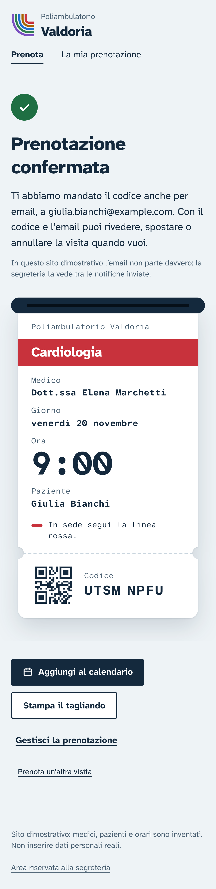
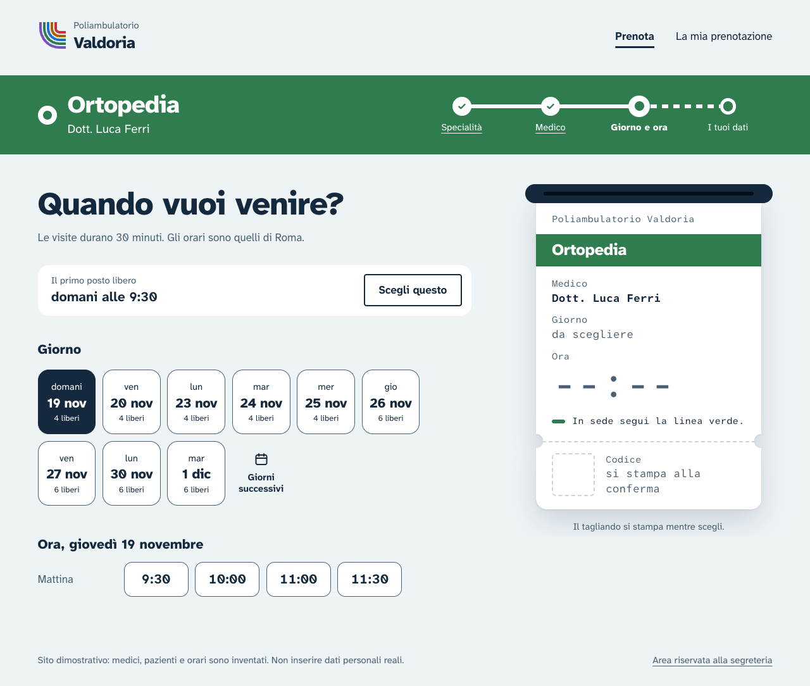
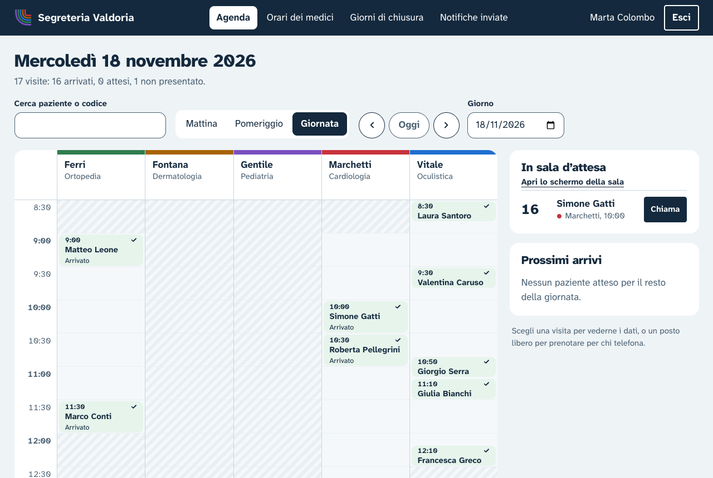
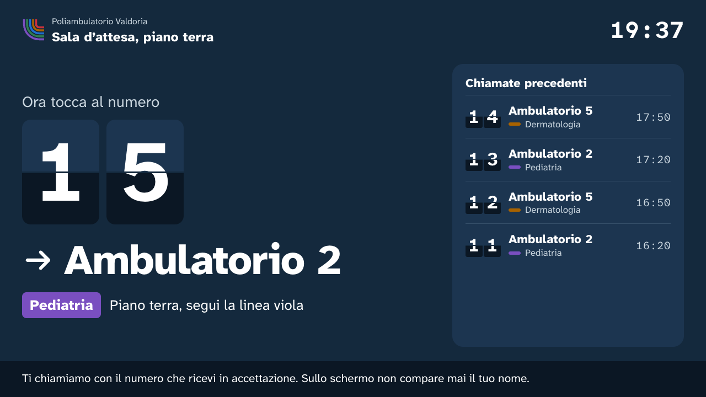
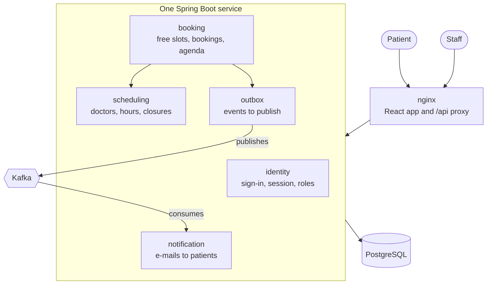
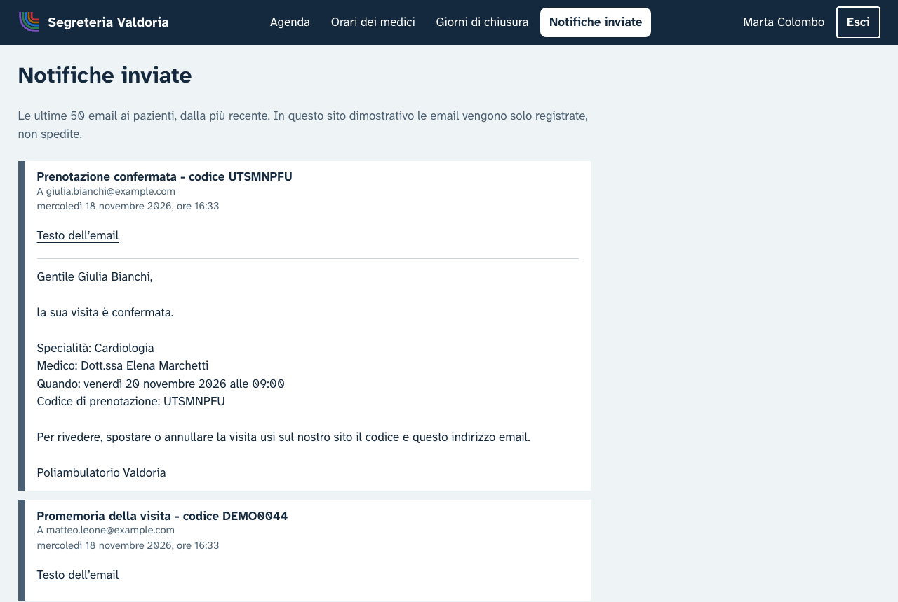

# Agenda Ambulatorio

Appointment booking for an outpatient clinic: patients book without an account, the front desk runs the agenda, and the same slot cannot be booked twice, not even by simultaneous requests.

[](https://github.com/Il-Sic/agenda-ambulatorio/actions/workflows/ci.yml)

[Versione italiana](README.md)

> Demonstration project. "Poliambulatorio Valdoria" does not exist: doctors, patients and times are invented and there is no real health data. The user interface is in Italian.


<p>
  
  
  
</p>

The interface borrows hospital wayfinding: one coloured line per specialty, to follow all the way to the ticket, which prints as you choose. The choices are explained in the [decision on the visual language](docs/adr/0006-wayfinding-as-visual-language.md).


## Try it in a minute

You only need Docker.

```bash
git clone https://github.com/Il-Sic/agenda-ambulatorio.git
cd agenda-ambulatorio
docker compose up --build
```

When the containers are ready, open <http://localhost:8080>. The first start builds backend and frontend and takes a few minutes.

| What to try | Where |
|---|---|
| Book a visit by following the line of a specialty | <http://localhost:8080> |
| View, move or cancel it with code and e-mail; add it to a calendar, print the ticket | "La mia prenotazione" |
| The day's agenda as a grid, bookings for callers, doctors' hours, closure days, sent e-mails | <http://localhost:8080/segreteria> |
| The waiting room screen, which calls numbers and never names | <http://localhost:8080/sala> |
| API documentation | <http://localhost:8080/swagger-ui/index.html> |

Demo credentials for the staff area:

| User | Password | Role |
|---|---|---|
| `segreteria` | `segreteria-demo` | `STAFF`: daily agenda and notifications |
| `admin` | `admin-demo` | `ADMIN`: can also change hours and closure days |

They only exist in this local demo: they are created by the demo data, which is loaded only by Docker Compose. The same goes for the database password in `compose.yaml`.

A suggested tour: book a visit, then sign in as `segreteria` and open "Notifiche inviate". The confirmation e-mail you find there travelled through Kafka.

Then the waiting room: open <http://localhost:8080/sala> in another window, mark a patient as arrived in the agenda and press "Chiama" under "In sala d'attesa". The number shows up on the screen within seconds; open that patient's booking on a phone (the code and e-mail are in the visit's details) and the page says "È il tuo turno".

If port 8080 is taken, copy `.env.example` to `.env` and change `APP_PORT`. The site only answers from your own computer; to open it from a phone on the same network set `APP_BIND=0.0.0.0` in the same file. To start again from the initial data: `docker compose down -v`.







## What it demonstrates

| Aspect | Where to look |
|---|---|
| No double booking, guaranteed by the database with an exclusion constraint | [`002-booking.sql`](backend/src/main/resources/db/changelog/changes/002-booking.sql) |
| The proof: twelve requests at the same instant, one booking | [`ConcurrentBookingTest`](backend/src/test/java/io/github/ilsic/agenda/booking/ConcurrentBookingTest.java) |
| Call numbers counted per day: different even for arrivals at the same instant, without gaps | [`CallNumbers`](backend/src/main/java/io/github/ilsic/agenda/booking/CallNumbers.java), [`WaitingRoomApiTest`](backend/src/test/java/io/github/ilsic/agenda/booking/WaitingRoomApiTest.java) |
| A public screen that never shows a name, and a patient's phone that updates by itself | [`WaitingRoomPage`](frontend/src/waiting-room/WaitingRoomPage.tsx), [`turn.ts`](frontend/src/patient/turn.ts) |
| Booking is safe to retry: the same request sent again with the same idempotency key creates no duplicate | [`IdempotentBooking`](backend/src/main/java/io/github/ilsic/agenda/booking/IdempotentBooking.java), [`BookingIdempotencyTest`](backend/src/test/java/io/github/ilsic/agenda/booking/BookingIdempotencyTest.java) |
| Free slots computed by a single SQL query, daylight saving time included | [`FreeSlotFinder`](backend/src/main/java/io/github/ilsic/agenda/booking/FreeSlotFinder.java), [`FreeSlotFinderTest`](backend/src/test/java/io/github/ilsic/agenda/booking/FreeSlotFinderTest.java) |
| Transactional outbox: the event is born in the same transaction as the booking | [`Outbox`](backend/src/main/java/io/github/ilsic/agenda/outbox/Outbox.java), [`BookingService`](backend/src/main/java/io/github/ilsic/agenda/booking/BookingService.java) |
| Publishing to Kafka with `FOR UPDATE SKIP LOCKED` | [`OutboxPublisher`](backend/src/main/java/io/github/ilsic/agenda/outbox/OutboxPublisher.java), [`OutboxPublisherTest`](backend/src/test/java/io/github/ilsic/agenda/outbox/OutboxPublisherTest.java) |
| Idempotent consumer: an event delivered twice produces one e-mail | [`SimulatedEmailSender`](backend/src/main/java/io/github/ilsic/agenda/notification/SimulatedEmailSender.java) |
| Moving a visit in one transaction: never a moment without a visit, or with two | [`BookingService.reschedule`](backend/src/main/java/io/github/ilsic/agenda/booking/BookingService.java), [`BookingReschedulingApiTest`](backend/src/test/java/io/github/ilsic/agenda/booking/BookingReschedulingApiTest.java) |
| A reminder the day before the visit, through the same event path as the other e-mails | [`VisitReminders`](backend/src/main/java/io/github/ilsic/agenda/booking/VisitReminders.java), [`VisitRemindersTest`](backend/src/test/java/io/github/ilsic/agenda/booking/VisitRemindersTest.java) |
| One modular service, with boundaries verified on every build | [`ModularityTest`](backend/src/test/java/io/github/ilsic/agenda/ModularityTest.java) |
| Session in an HttpOnly cookie, CSRF, two roles, everything else denied | [`SecurityConfiguration`](backend/src/main/java/io/github/ilsic/agenda/identity/SecurityConfiguration.java), [`AccessRulesTest`](backend/src/test/java/io/github/ilsic/agenda/identity/AccessRulesTest.java) |
| Errors as Problem Details, told apart by a stable `type` | [`BookingExceptionHandler`](backend/src/main/java/io/github/ilsic/agenda/booking/BookingExceptionHandler.java) |
| API contract always in step: OpenAPI schema → TypeScript types, checked in CI | [`OpenApiSpecTest`](backend/src/test/java/io/github/ilsic/agenda/OpenApiSpecTest.java), [`client.ts`](frontend/src/api/client.ts) |
| Phone-first, accessible interface, with axe on every screen | [`Home`](frontend/src/patient/Home.tsx), [`DayGrid`](frontend/src/staff/agenda/DayGrid.tsx), [`accessibility.ts`](e2e/tests/accessibility.ts) |
| End-to-end tests through the whole stack, Kafka included | [`staff-agenda.spec.ts`](e2e/tests/staff-agenda.spec.ts) |

## Architecture



- **One service, five modules.** Each module is a package that declares what it may depend on; a test fails the build when the rule is broken.
- **`notification` can only be reached through Kafka.** No other module calls it, and it knows none of their classes: they share only the topic name and the JSON format of the event.
- **nginx serves the page and proxies `/api`.** The browser talks to a single origin, so session cookie and CSRF work without CORS.

The journey of a booking:

1. `booking` checks that the slot is one of those offered and inserts the visit. If another request got there first, the exclusion constraint refuses the insert and the API answers 409.
2. In the same transaction it writes the event to the `outbox_event` table.
3. `outbox` publishes the event to Kafka and marks it as published.
4. `notification` consumes it, writes the e-mail, and the staff see it under "Notifiche inviate".



## Technical choices

Every important decision has a page explaining context, decision, consequences and the alternatives that were set aside.

| Decision | In short |
|---|---|
| [One modular service](docs/adr/0001-one-modular-service.md) | Real boundaries without the operational cost of microservices |
| [Database constraint against double booking](docs/adr/0002-database-constraint-against-double-booking.md) | The rule holds for every writer, even under concurrency |
| [JPA together with native SQL](docs/adr/0003-jpa-with-native-sql.md) | JPA for entities, SQL where PostgreSQL's power is needed |
| [Session instead of JWT](docs/adr/0004-session-instead-of-jwt.md) | No token readable by JavaScript, immediate sign-out |
| [Outbox instead of publishing directly](docs/adr/0005-transactional-outbox.md) | No lost events and no events for data that was never saved |
| [Wayfinding as the visual language](docs/adr/0006-wayfinding-as-visual-language.md) | Coloured lines as structure, the ticket as the only object |
| [The waiting room calls numbers](docs/adr/0007-waiting-room-calls.md) | Never a name on the screen; numbers without duplicates or gaps; screens that ask every few seconds |

Stack: Java 25, Spring Boot 4.1, PostgreSQL 18, Liquibase, Kafka 4.4 in KRaft mode, React 19, TypeScript, Vite, TanStack Query, React Hook Form with Zod, Tailwind CSS.

## Tests

| Level | What it covers | How to run it |
|---|---|---|
| Backend | Database constraints, concurrency, daylight saving time, API, security, outbox and consumer against real PostgreSQL and Kafka (Testcontainers), module boundaries | `cd backend && ./mvnw verify` |
| Frontend | Every page used the way a person would, against a fake backend | `cd frontend && npm ci && npm test` |
| End to end | The patient books, the staff cancel, the e-mail arrives; the desk calls a number and the screen and the phone show it; on a computer and on a phone, with accessibility checks | see below |

The backend needs JDK 25 and a running Docker. The frontend needs Node 24 or 26.

The end-to-end tests run against the stack started with Docker Compose:

```bash
docker compose up --build --detach --wait
cd e2e
npm ci
npx playwright install chromium
npm test
```

A few details that matter:

- Backend tests run with the JVM in the Tokyo time zone: code that depends on the machine's zone fails everywhere, not only in production.
- The concurrency test was made to fail on purpose: with the constraint removed, ten requests out of twelve manage to book the same slot.
- CI runs all three levels and checks formatting, lint, types, and that the types generated from the API are up to date.

## Local development

With the Docker stack stopped (`docker compose down`), in two terminals:

```bash
# Backend on http://localhost:8080, with throwaway PostgreSQL and Kafka and the demo data
cd backend
LIQUIBASE_CONTEXTS=demo ./mvnw spring-boot:test-run
```

```bash
# Frontend on http://localhost:5173, proxies /api to the backend
cd frontend
npm ci
npm run dev
```

After changing the API:

```bash
cd backend && ./mvnw test -Dtest=OpenApiSpecTest -Dopenapi.update=true   # updates docs/openapi.json
cd ../frontend && npm run api:generate                                   # updates the TypeScript types
```

## Known limits and what I would do next

- **Sessions in memory.** It works with a single backend instance. For more I would add Spring Session on JDBC or Redis.
- **Simulated e-mails.** They are stored and shown to the staff. The next step is real delivery behind the same interface.
- **No attempt limit.** Someone trying many booking codes or passwords is not slowed down. I would add a limit per IP address.
- **Closures and hours do not touch existing bookings.** If a day is closed, the visits already in the agenda stay there and must be cancelled by hand.
- **Outbox without clean-up.** Published rows stay in the table. A periodic job should archive them.
- **An event that cannot be processed is dropped after ten attempts in quick succession.** That is right for an unreadable message; if the database stays down longer, that e-mail is lost. I would add retries spaced out over time and a topic for messages that cannot be processed.
- **Single-node Kafka and plain HTTP.** Fine for a demo, not for production.
- **Screens that ask every few seconds.** The waiting room screen and the patient's phone ask for news every 3 to 5 seconds. With many screens I would move to Server-Sent Events, with the news shared between instances.
- **Docker Compose only.** To run it on Kubernetes I would add a Helm chart.

## License

[MIT](LICENSE)
