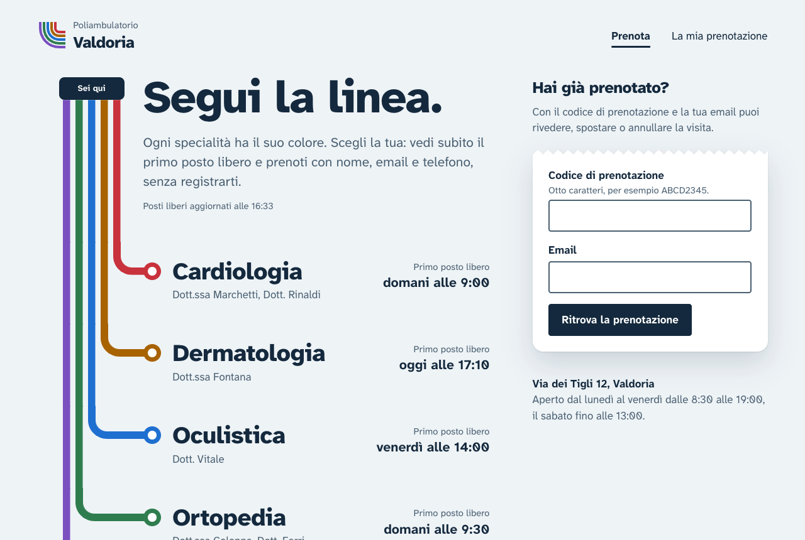
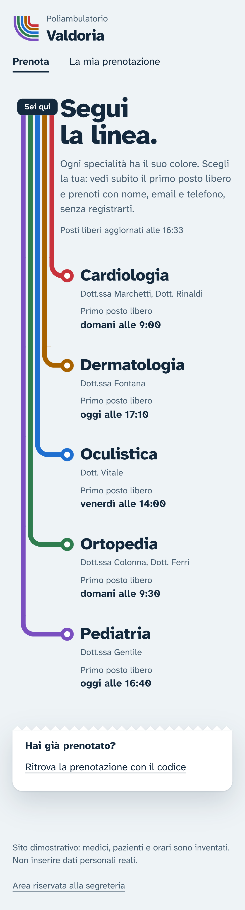
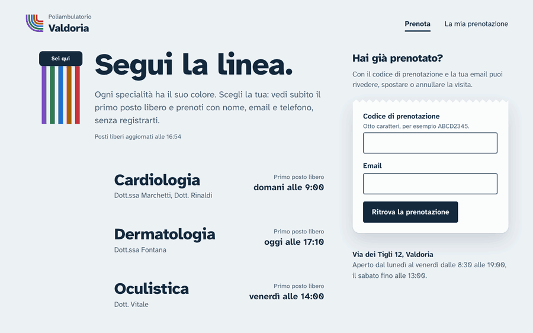
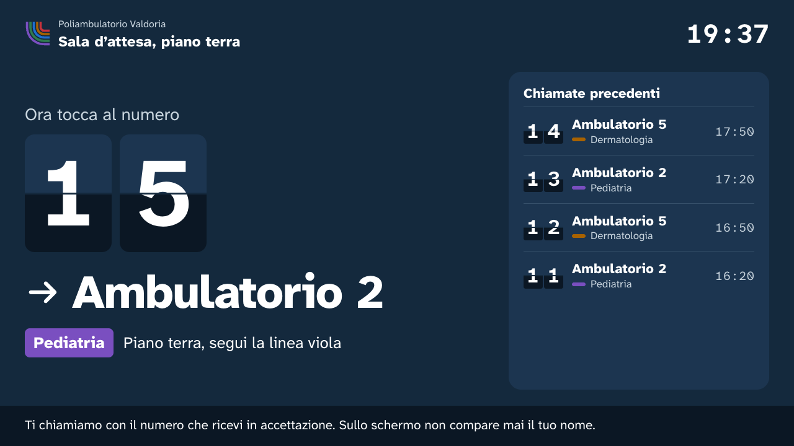

# Agenda Ambulatorio

Prenotazione delle visite per un poliambulatorio: il paziente prenota senza account, la segreteria gestisce l'agenda, e lo stesso orario non può essere prenotato due volte nemmeno con richieste contemporanee.

[](https://github.com/Il-Sic/agenda-ambulatorio/actions/workflows/ci.yml)

[English version](README.en.md)

> Progetto dimostrativo. Il «Poliambulatorio Valdoria» non esiste: medici, pazienti e orari sono inventati e non c'è alcun dato sanitario reale.



<p>
  
  
  
</p>

L'interfaccia prende a prestito la segnaletica degli ospedali: una linea colorata per ogni specialità, da seguire fino al tagliando, che si stampa mentre scegli. Le scelte sono spiegate nella [decisione sul linguaggio visivo](docs/adr/0006-wayfinding-as-visual-language.md).



## Provalo in un minuto

Serve solo Docker.

```bash
git clone https://github.com/Il-Sic/agenda-ambulatorio.git
cd agenda-ambulatorio
docker compose up --build
```

Quando i container sono pronti apri <http://localhost:8080>. Il primo avvio compila backend e frontend e richiede qualche minuto.

| Cosa provare | Dove |
|---|---|
| Prenotare una visita seguendo la linea della specialità | <http://localhost:8080> |
| Rivedere, spostare o annullare con codice ed email; aggiungere la visita al calendario, stampare il tagliando | «La mia prenotazione» |
| Agenda del giorno a griglia, prenotazioni per chi telefona, orari, chiusure, email inviate | <http://localhost:8080/segreteria> |
| Lo schermo della sala d'attesa, che chiama i numeri e mai i nomi | <http://localhost:8080/sala> |
| Documentazione dell'API | <http://localhost:8080/swagger-ui/index.html> |

Credenziali di esempio per l'area segreteria:

| Utente | Password | Ruolo |
|---|---|---|
| `segreteria` | `segreteria-demo` | `STAFF`: agenda del giorno e notifiche |
| `admin` | `admin-demo` | `ADMIN`: in più modifica orari e chiusure |

Valgono solo in questa demo locale: le crea il caricamento dei dati di esempio, che parte soltanto con Docker Compose. Lo stesso vale per la password del database in `compose.yaml`.

Un giro consigliato: prenota una visita, poi entra come `segreteria` e apri «Notifiche inviate». L'email di conferma che trovi lì è passata da Kafka.

Poi la sala d'attesa: apri <http://localhost:8080/sala> in un'altra finestra, segna arrivato un paziente in agenda e premi «Chiama» in «In sala d'attesa». Il numero compare sullo schermo in pochi secondi; se apri la sua prenotazione da telefono (codice ed email sono nei dati della visita), la pagina dice «È il tuo turno».

Se la porta 8080 è occupata, copia `.env.example` in `.env` e cambia `APP_PORT`. Il sito risponde solo dal tuo computer; per aprirlo da un telefono sulla stessa rete imposta `APP_BIND=0.0.0.0` nello stesso file. Per ripartire dai dati iniziali: `docker compose down -v`.




## Cosa dimostra

| Aspetto | Dove guardare |
|---|---|
| Nessuna doppia prenotazione, garantita dal database con un vincolo di esclusione | [`002-booking.sql`](backend/src/main/resources/db/changelog/changes/002-booking.sql) |
| La prova: dodici richieste nello stesso istante, una sola prenotazione | [`ConcurrentBookingTest`](backend/src/test/java/io/github/ilsic/agenda/booking/ConcurrentBookingTest.java) |
| Numeri di chiamata progressivi per giorno: diversi anche per arrivi nello stesso istante, senza buchi | [`CallNumbers`](backend/src/main/java/io/github/ilsic/agenda/booking/CallNumbers.java), [`WaitingRoomApiTest`](backend/src/test/java/io/github/ilsic/agenda/booking/WaitingRoomApiTest.java) |
| Uno schermo pubblico che non mostra mai un nome, e il telefono del paziente che si aggiorna da solo | [`WaitingRoomPage`](frontend/src/waiting-room/WaitingRoomPage.tsx), [`turn.ts`](frontend/src/patient/turn.ts) |
| Prenotazione ripetibile: la stessa richiesta rimandata con la stessa chiave di idempotenza non crea doppioni | [`IdempotentBooking`](backend/src/main/java/io/github/ilsic/agenda/booking/IdempotentBooking.java), [`BookingIdempotencyTest`](backend/src/test/java/io/github/ilsic/agenda/booking/BookingIdempotencyTest.java) |
| Orari liberi calcolati con una sola query SQL, cambio dell'ora legale compreso | [`FreeSlotFinder`](backend/src/main/java/io/github/ilsic/agenda/booking/FreeSlotFinder.java), [`FreeSlotFinderTest`](backend/src/test/java/io/github/ilsic/agenda/booking/FreeSlotFinderTest.java) |
| Outbox transazionale: l'evento nasce nella stessa transazione della prenotazione | [`Outbox`](backend/src/main/java/io/github/ilsic/agenda/outbox/Outbox.java), [`BookingService`](backend/src/main/java/io/github/ilsic/agenda/booking/BookingService.java) |
| Pubblicazione su Kafka con `FOR UPDATE SKIP LOCKED` | [`OutboxPublisher`](backend/src/main/java/io/github/ilsic/agenda/outbox/OutboxPublisher.java), [`OutboxPublisherTest`](backend/src/test/java/io/github/ilsic/agenda/outbox/OutboxPublisherTest.java) |
| Consumer idempotente: un evento consegnato due volte produce una sola email | [`SimulatedEmailSender`](backend/src/main/java/io/github/ilsic/agenda/notification/SimulatedEmailSender.java) |
| Spostare una visita in una sola transazione: mai un momento senza visita, o con due | [`BookingService.reschedule`](backend/src/main/java/io/github/ilsic/agenda/booking/BookingService.java), [`BookingReschedulingApiTest`](backend/src/test/java/io/github/ilsic/agenda/booking/BookingReschedulingApiTest.java) |
| Promemoria il giorno prima della visita, con lo stesso percorso a eventi delle altre email | [`VisitReminders`](backend/src/main/java/io/github/ilsic/agenda/booking/VisitReminders.java), [`VisitRemindersTest`](backend/src/test/java/io/github/ilsic/agenda/booking/VisitRemindersTest.java) |
| Un solo servizio a moduli, con i confini verificati a ogni build | [`ModularityTest`](backend/src/test/java/io/github/ilsic/agenda/ModularityTest.java) |
| Sessione su cookie HttpOnly, CSRF, due ruoli, tutto il resto negato | [`SecurityConfiguration`](backend/src/main/java/io/github/ilsic/agenda/identity/SecurityConfiguration.java), [`AccessRulesTest`](backend/src/test/java/io/github/ilsic/agenda/identity/AccessRulesTest.java) |
| Errori in formato Problem Details, distinti da un `type` stabile | [`BookingExceptionHandler`](backend/src/main/java/io/github/ilsic/agenda/booking/BookingExceptionHandler.java) |
| Contratto dell'API sempre allineato: schema OpenAPI → tipi TypeScript, controllati in CI | [`OpenApiSpecTest`](backend/src/test/java/io/github/ilsic/agenda/OpenApiSpecTest.java), [`client.ts`](frontend/src/api/client.ts) |
| Interfaccia pensata per il telefono e accessibile, con axe a ogni schermata | [`Home`](frontend/src/patient/Home.tsx), [`DayGrid`](frontend/src/staff/agenda/DayGrid.tsx), [`accessibility.ts`](e2e/tests/accessibility.ts) |
| Test end to end attraverso tutto lo stack, Kafka compreso | [`staff-agenda.spec.ts`](e2e/tests/staff-agenda.spec.ts) |

## Architettura


- **Un solo servizio, cinque moduli.** Ogni modulo è un package che dichiara da chi può dipendere; un test fa fallire la build se qualcuno sgarra.
- **`notification` è raggiungibile solo da Kafka.** Nessun altro modulo lo chiama, e lui non conosce le classi degli altri: condividono solo il nome del topic e il formato JSON dell'evento.
- **nginx serve la pagina e inoltra `/api`.** Il browser parla con una sola origine, quindi cookie di sessione e CSRF funzionano senza CORS.

Il percorso di una prenotazione:

1. `booking` controlla che l'orario sia tra quelli offerti e inserisce la visita. Se un'altra richiesta è arrivata prima, il vincolo di esclusione rifiuta l'inserimento e l'API risponde 409.
2. Nella stessa transazione scrive l'evento nella tabella `outbox_event`.
3. `outbox` pubblica l'evento su Kafka e lo segna come pubblicato.
4. `notification` lo consuma, scrive l'email e la segreteria la vede in «Notifiche inviate».


## Scelte tecniche

Ogni decisione importante ha una pagina che spiega contesto, scelta, conseguenze e alternative scartate.

| Decisione | In breve |
|---|---|
| [Un solo servizio a moduli](docs/adr/0001-one-modular-service.md) | Confini veri senza il costo operativo dei microservizi |
| [Vincolo nel database contro la doppia prenotazione](docs/adr/0002-database-constraint-against-double-booking.md) | La regola vale per chiunque scriva, anche sotto concorrenza |
| [JPA insieme a SQL nativo](docs/adr/0003-jpa-with-native-sql.md) | JPA per le entità, SQL dove serve la potenza di PostgreSQL |
| [Sessione invece di JWT](docs/adr/0004-session-instead-of-jwt.md) | Niente token leggibili da JavaScript, uscita immediata |
| [Outbox invece della pubblicazione diretta](docs/adr/0005-transactional-outbox.md) | Nessun evento perso e nessun evento per dati mai salvati |
| [La segnaletica come linguaggio visivo](docs/adr/0006-wayfinding-as-visual-language.md) | Linee colorate come struttura, il tagliando come unico oggetto |
| [La sala d'attesa chiama numeri](docs/adr/0007-waiting-room-calls.md) | Mai un nome sullo schermo; numeri senza doppioni né buchi; schermi che chiedono ogni pochi secondi |
| [Un chart Helm con manifest propri](docs/adr/0008-helm-chart.md) | PostgreSQL e Kafka scritti nel chart e sostituibili con servizi esistenti; privilegi minimi; password generata una volta |

Stack: Java 25, Spring Boot 4.1, PostgreSQL 18, Liquibase, Kafka 4.4 in modalità KRaft, React 19, TypeScript, Vite, TanStack Query, React Hook Form con Zod, Tailwind CSS.

## Test

| Livello | Cosa copre | Come lanciarlo |
|---|---|---|
| Backend | Vincoli del database, concorrenza, ora legale, API, sicurezza, outbox e consumer con PostgreSQL e Kafka veri (Testcontainers), confini dei moduli | `cd backend && ./mvnw verify` |
| Frontend | Ogni pagina usata come farebbe una persona, contro un backend finto | `cd frontend && npm ci && npm test` |
| End to end | Il paziente prenota, la segreteria annulla, l'email arriva; la segreteria chiama un numero e schermo e telefono lo mostrano; da computer e da telefono, con controlli di accessibilità | vedi sotto |

Il backend richiede JDK 25 e Docker acceso. Il frontend richiede Node 24 o 26.

I test end to end girano contro lo stack avviato con Docker Compose:

```bash
docker compose up --build --detach --wait
cd e2e
npm ci
npx playwright install chromium
npm test
```

Alcuni dettagli che contano:

- I test del backend girano con la JVM nel fuso di Tokyo: se il codice dipende dal fuso della macchina, fallisce ovunque e non solo in produzione.
- Il test di concorrenza è stato fatto fallire apposta: tolto il vincolo, dieci richieste su dodici riescono a prenotare lo stesso orario.
- La CI esegue tutti e tre i livelli e controlla formattazione, lint, tipi e che i tipi generati dall'API siano aggiornati.

## Sviluppo in locale

Con lo stack Docker fermo (`docker compose down`), in due terminali:

```bash
# Backend su http://localhost:8080, con PostgreSQL e Kafka usa e getta e i dati di esempio
cd backend
LIQUIBASE_CONTEXTS=demo ./mvnw spring-boot:test-run
```

```bash
# Frontend su http://localhost:5173, inoltra /api al backend
cd frontend
npm ci
npm run dev
```

Dopo una modifica all'API:

```bash
cd backend && ./mvnw test -Dtest=OpenApiSpecTest -Dopenapi.update=true   # aggiorna docs/openapi.json
cd ../frontend && npm run api:generate                                   # aggiorna i tipi TypeScript
```

## Su Kubernetes

Il chart Helm in [`deploy/helm/agenda-ambulatorio`](deploy/helm/agenda-ambulatorio) installa backend e frontend e, per una demo autonoma, anche PostgreSQL e un nodo Kafka. L'ho provato su un cluster locale creato con [kind](https://kind.sigs.k8s.io/): installazione, aggiornamento, disinstallazione e reinstallazione, e tutti i test end to end attraverso un port-forward.

```bash
kind create cluster --name agenda
docker compose build
docker save agenda-ambulatorio-backend:latest agenda-ambulatorio-frontend:latest -o /tmp/agenda.tar
kind load image-archive /tmp/agenda.tar --name agenda
helm install demo deploy/helm/agenda-ambulatorio --wait
kubectl port-forward service/demo-agenda-ambulatorio-frontend 8080:8080
```

Poi <http://localhost:8080>, come con Docker Compose. Le immagini non sono pubblicate su un registro, per questo passano da un archivio caricato nel cluster.

| Per | Valori |
|---|---|
| Usare un database e un Kafka già esistenti | `postgresql.enabled=false` con `postgresql.external.host` e `postgresql.existingSecret`; `kafka.enabled=false` con `kafka.external.bootstrapServers` |
| Aprire il sito con un dominio e HTTPS | `ingress.enabled=true`, `ingress.host`, `ingress.tls=true` con `ingress.tlsSecretName`: il cookie di sessione diventa `Secure` |
| Partire senza dati di esempio | `demoData=false`: attenzione, senza dati di esempio non c'è nessun account della segreteria |

La password del database viene generata all'installazione e conservata negli aggiornamenti. Ogni container gira senza privilegi di root e senza capability Linux, con il filesystem in sola lettura dove l'immagine lo permette; il backend ha controlli di salute distinti per «vivo» e «pronto». Le scelte sono spiegate nell'[ADR 8](docs/adr/0008-helm-chart.md).

## Limiti noti e cosa farei dopo

- **Sessioni in memoria.** Funziona con una sola istanza del backend. Per averne di più aggiungerei Spring Session su JDBC o Redis.
- **Email simulate.** Vengono salvate e mostrate alla segreteria. Il passo successivo è un vero invio dietro la stessa interfaccia.
- **Nessun limite ai tentativi.** Chi prova molti codici di prenotazione o molte password non viene rallentato. Metterei un limite per indirizzo IP.
- **Chiusure e orari non toccano le visite già prenotate.** Se si chiude un giorno, le visite già in agenda restano e vanno annullate a mano.
- **Outbox senza pulizia.** Le righe pubblicate restano in tabella. Servirebbe un lavoro periodico che le archivia.
- **Un evento che non si riesce a elaborare viene scartato dopo dieci tentativi ravvicinati.** Va bene per un messaggio illeggibile; se invece il database resta fermo più a lungo, quell'email si perde. Aggiungerei tentativi distanziati nel tempo e un topic per i messaggi non elaborabili.
- **Kafka a un solo nodo e HTTP in chiaro.** Va bene per una demo, non per la produzione.
- **Schermi che chiedono ogni pochi secondi.** Lo schermo della sala e il telefono del paziente chiedono le novità ogni 3–5 secondi. Con molti schermi passerei a Server-Sent Events, con le novità condivise tra le istanze.
- **Immagini non pubblicate.** Il chart Helm le trova nel cluster o in un registro indicato nei valori. Il passo successivo è pubblicarle dalla CI, con una versione per ogni rilascio.

## Licenza

[MIT](LICENSE)
